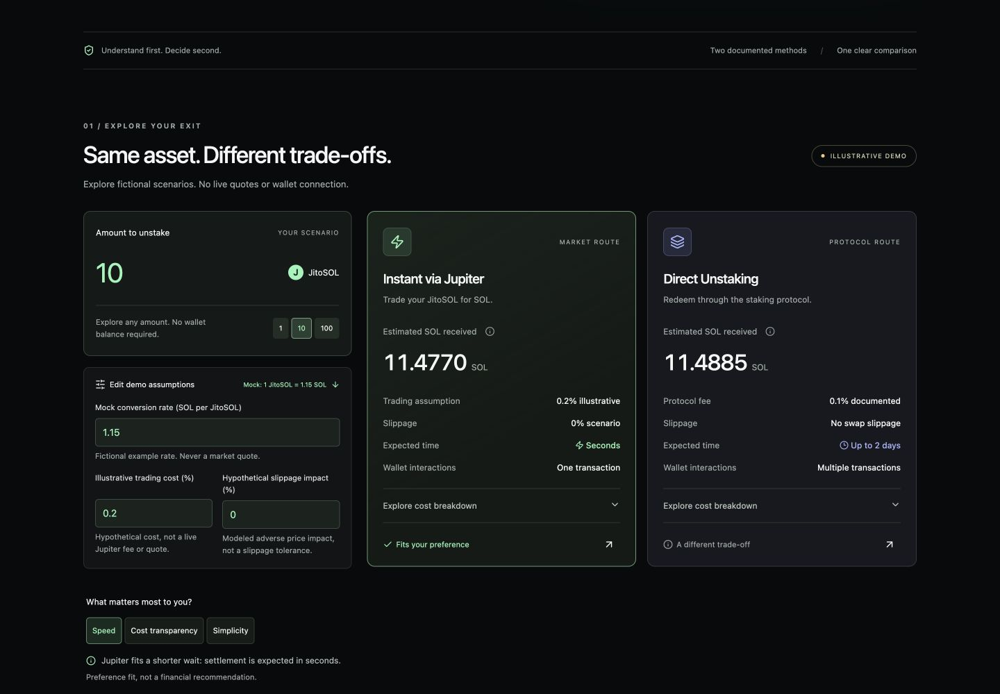

# Jito Exit Clarity

**Know what you’ll receive before you unstake.**

An independent, interactive frontend UX concept prepared as supporting material for a TokenGems research contribution on Superteam Earn. It explores an earlier explanation of JitoSOL withdrawal choices. It is not affiliated with or endorsed by Jito.



**[Live demo](https://jito-exit-clarity.vercel.app)** · **[GitHub repository](https://github.com/azimxxd/jito-exit-clarity)**

## Purpose and hypothesis

Jito’s homepage emphasizes liquidity and no exit penalties. Its official documentation already compares instant Jupiter trading with direct unstaking. The proposal is to make that understanding available earlier: before wallet connection. We do not claim that fees are hidden, or that the wallet-connected experience has been comprehensively audited.

Hypothesis: a pre-connection comparison could improve comprehension of costs, timing and required interactions. This remains unvalidated; there are no interviews, transaction observations or usability results behind this prototype.

## Stack and features

React, strict TypeScript, Vite, Tailwind CSS, Lucide React and Motion. All calculations run locally. No API keys, backend, wallet integration or blockchain transactions.

- Editable amount with 1 / 10 / 100 presets; no invented MAX balance.
- Side-by-side output estimates, expandable cost explanations and focus/click tooltips.
- Editable mock conversion rate, hypothetical trading costs and slippage impact, visible by default.
- An expandable guide explains exchange rates, fees, slippage, timing and excluded costs.
- Preference highlighting for speed, cost transparency or simplicity, with a reason.
- Outcome bars, comparison table, selectable method timelines and linked research evidence with a proposed discovery journey.
- Neutral concept branding and above-the-fold non-affiliation disclosure.
- Responsive layouts, keyboard access, reduced-motion support and animated values.
- Explicit input validation: blank, malformed, negative, nonfinite and excessive inputs hide estimates.

## Financial limitations

Default **fictional** assumptions: 1 JitoSOL = 1.15 SOL; 0.2% trading cost; 0% modeled slippage. These are not live or historical quotes. The direct method models the documented 0.1% protocol unstaking fee.

`gross = amount × mock rate`

`instant fee = gross × tradingPercent / 100`

`instant slippage = (gross − instant fee) × slippagePercent / 100`

`instant received = gross − instant fee − instant slippage`

`direct received = gross − (gross × 0.1 / 100)`

The same mock rate is used for both routes to isolate the modeled costs. In a real implementation, market execution prices and protocol exchange rates can differ. Network fees, priority fees, account funding/rent, routing effects and other execution costs are not included. The slippage input is a modeled adverse price impact, not a swap tolerance or guaranteed loss. No method is financially recommended. “Cost transparency” highlights a defined protocol fee, not a promise of lower total costs.

Amounts are displayed to four decimals; positive values below the rounding threshold are shown as `<0.0001` rather than zero. Internal calculations use JavaScript floating-point arithmetic. The prototype is suitable for education, not settlement or transaction accounting. Limits: amount 0–1,000,000, rate above 0 up to 100, trading/slippage assumptions 0–10%; at most nine decimal places.

## Local setup

Use Node.js 24.x LTS and npm. The `.nvmrc` selects Node 24, matching the build runtime and Vercel configuration. Dependencies are pinned by `package-lock.json`.

```sh
cd jito-exit-clarity
npm ci
npm run dev
```

Open the local URL printed by Vite. To validate and preview the production output:

```sh
npm test
npm run build
npm run preview
```

## Deployment

This is a static application. For Vercel, Netlify or Cloudflare Pages, select the project directory, use `npm run build`, and set the output directory to `dist`. No environment variables are required. Alternatively, serve the generated `dist` directory through any static host. There are no client-side path routes requiring a fallback.

The Vercel configuration is committed in `vercel.json`. A GitHub Actions workflow checks tests and builds on `main` and pull requests.

The production site is live at [jito-exit-clarity.vercel.app](https://jito-exit-clarity.vercel.app), with source at [azimxxd/jito-exit-clarity](https://github.com/azimxxd/jito-exit-clarity). Vercel is connected to GitHub for subsequent deployments. See [release record](docs/RELEASE.md).

The competition requires a public TokenGems contribution and profile link; the demo alone is not an entry. See [verified participation requirements](docs/COMPETITION.md). The contribution draft has not been posted or submitted.

## Source structure

- `src/calculations.ts`: typed scenario calculations, bounds, parsing and formatting.
- `src/components/EstimateGuide.tsx`: explanations of model assumptions and withdrawal expectations.
- `src/sources.ts`: shared official reference links.
- `src/components/Interface.tsx`: Header, Hero, AmountInput, ComparisonCard, FeeBreakdown, MethodTimeline, ResearchSection, Footer and shared elements.
- `src/App.tsx`: scenario state, comparison visualization and case-study composition.
- `src/styles.css`: responsive visual system and reduced-motion styles.
- `tests/calculations.test.ts`: meaningful model and validation checks using Node’s built-in test runner through tsx.
- `docs/RESEARCH.md`: source references and research boundaries.
- `docs/QA.md`: checks and visual verification.
- `docs/COMPETITION.md`: contest status, project eligibility and required user steps.
- `docs/RELEASE.md`: GitHub, Vercel and publication approval boundaries.

## Official references

- [JitoSOL product page](https://www.jito.network/jitosol/)
- [Official unstaking overview](https://www.jito.network/docs/jitosol/get-started/unstaking-jitosol-flow/unstaking-overview/)

Reviewed on 13 October 2026. Fees and protocol behavior may change; verify official data before a production integration.

## Release verification

Run `npm run check` before publication. The current automated suite covers decimal input validation, bounds, fee/slippage math, zero amounts, exact ties, small positive outputs and reconciliation with gross values. Browser verification is documented in [QA notes](docs/QA.md). These engineering checks are not usability research or a security audit.

There are no application secrets or environment variables. `.env` files, Vercel account state, dependencies and build output are ignored. The app has no analytics, account persistence or APIs.

## Research contribution

[English contribution draft](TOKEN_GEMS_SUBMISSION.md) · [Research scope](docs/RESEARCH.md)

JitoSOL is listed on TokenGems in Solana. The contest was open when checked on 13 October 2026; verify its current deadline before submission. The draft distinguishes observation, hypothesis, proposal and unperformed validation. It also discloses AI assistance.

No open-source license has been selected. This repository is an independent portfolio concept, not an official Jito application.
